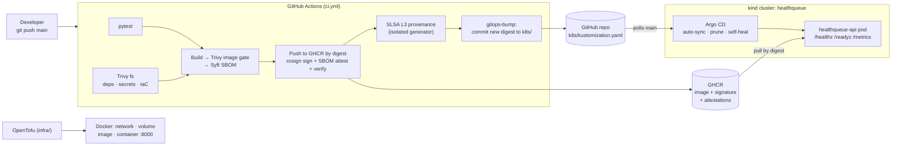

# HealthQueue — Appointment Scheduling API (DevOps Capstone)

Patient-facing appointment scheduling API for HealthQueue, a health-tech startup, with a
production-grade DevOps pipeline: CI/CD with supply-chain security, OpenTofu infrastructure,
GitOps delivery to Kubernetes with Argo CD, and an observability plan with SLOs.
**All patient data is fictional.**

## Capstone requirements → evidence

| # | Requirement | Where | Verified result (2026-10-24) |
|---|---|---|---|
| 1 | CI/CD: automated build, test, security scanning, SBOM, signing | [`.github/workflows/ci.yml`](.github/workflows/ci.yml) | All 7 jobs green on the last 3 pushes to `main`; 13/13 unit tests pass; image signature, SBOM attestation and SLSA provenance verified independently with cosign |
| 2 | OpenTofu: ≥ 2 resources with state management | [`infra/`](infra/) | 4 resources (network, volume, image, container); encrypted state; `tofu validate` passes and `tofu plan` reports **No changes** |
| 3 | Containerized app on Kubernetes via GitOps | [`k8s/`](k8s/), [`argocd/`](argocd/), [`cluster/`](cluster/) | Argo CD **Synced / Healthy**; 2 automated deployments, each **~4–5 min from commit to running pod** |
| 4 | Observability plan: SLIs, SLOs, error budget | [`docs/monitoring-plan.md`](docs/monitoring-plan.md), [`observability/`](observability/) | 99.5 % availability / 95 % ≤ 300 ms SLOs; 30-day budget **216 min**; 34 Prometheus rules (19 recording, 15 alerts) pass `promtool` unit tests, enforced in CI |
| 5 | DORA baseline from 90 days of synthetic data | [`docs/dora-baseline.md`](docs/dora-baseline.md), [`docs/dora/`](docs/dora/) | Reproducible, seeded generator + metrics script; **synthetic** results clearly separated from real measurements |
| 6 | Supply chain security summary, SLSA alignment | [`docs/supply-chain-security.md`](docs/supply-chain-security.md) | Provenance verified as signed by the SLSA generator; Build L3 alignment (**self-assessed**) with gaps listed |

## Architecture



## Repository layout

| Path | Contents |
|---|---|
| `app/`, `tests/` | FastAPI service (in-memory store, fictional patients) and pytest suite |
| `Dockerfile` | Multi-stage, non-root (UID 10001), pip removed from the runtime image |
| `.github/` | CI/CD workflow and Dependabot config |
| `infra/` | OpenTofu: local Docker deployment with encrypted state ([infra/README.md](infra/README.md)) |
| `cluster/` | kind cluster definition |
| `argocd/` | Lean Argo CD install and the `healthqueue-api` Application |
| `k8s/` | Kubernetes manifests synced by Argo CD (image digest updated by CI) |
| `observability/` | Prometheus SLO recording/alert rules + unit tests (not deployed) |
| `docs/` | Monitoring plan, DORA baseline, supply chain security summary |

## Run locally

```powershell
# Windows (PowerShell)
python -m venv .venv
.venv\Scripts\Activate.ps1
pip install -r requirements-dev.txt
pytest -v                          # run tests
uvicorn app.main:app --reload      # http://localhost:8000/docs
```

```bash
# Linux / macOS
python3 -m venv .venv
source .venv/bin/activate
pip install -r requirements-dev.txt
pytest -v
uvicorn app.main:app --reload
```

With Docker:

```bash
docker build -t healthqueue-api:dev .
docker run -p 8000:8000 healthqueue-api:dev
```

## API

| Method | Path | Description |
|---|---|---|
| GET | `/patients` | List (fictional) patients |
| GET | `/appointments?patient_id=` | List appointments |
| POST | `/appointments` | Book (409 on provider double-booking) |
| GET | `/appointments/{id}` | Get one |
| DELETE | `/appointments/{id}` | Cancel |
| GET | `/healthz`, `/readyz` | Liveness / readiness probes (`/readyz` reports the deployed Git SHA) |
| GET | `/metrics` | Prometheus metrics (SLI source) |

## CI/CD pipeline (`.github/workflows/ci.yml`)

| Stage | Tool | Gate |
|---|---|---|
| Unit tests | pytest | any failure |
| Source scan | Trivy fs (deps, secrets, IaC misconfig) | HIGH/CRITICAL |
| Build | Docker Buildx, **once** (multi-stage, non-root, no pip at runtime) | — |
| Image scan | Trivy image (+ SARIF to Security tab) | HIGH/CRITICAL with a fix |
| SBOM | Syft (SPDX + CycloneDX) | — |
| Publish | GHCR: the scanned image is pushed as-is (no rebuild); the registry manifest is checked against the scanned image ID | main only |
| Sign | cosign keyless (Sigstore / GitHub OIDC) | main only |
| Attest | cosign SBOM attestation + SLSA L3 provenance | main only |
| Verify | `cosign verify` / `verify-attestation` | main only |
| Deliver | Digest bump in `k8s/` → Argo CD sync | main only |

Pull requests run everything up to the image scan and SBOM, but never publish or sign. Changes
only under `docs/`, `observability/` or `*.md` don't run the pipeline, so they don't redeploy.
The gate works: commit `2b0e5de` failed unit tests and was never published.

A second workflow, [`.github/workflows/validate.yml`](.github/workflows/validate.yml), checks the
configuration on **every** push and PR, including the `observability/` changes the main pipeline
skips. It builds and publishes nothing:

| Job | Checks |
|---|---|
| Prometheus rules | `promtool check rules` + `promtool test rules` (alert unit tests) |
| OpenTofu | `tofu fmt -check`, `tofu init -lockfile=readonly`, `tofu validate` |
| Kubernetes | `kustomize build` of `k8s/` and `argocd/`, then `kubeconform` schema checks against Kubernetes 1.34 |

## Infrastructure as code (OpenTofu)

[`infra/`](infra/) provisions the API on the local Docker Engine: a private bridge network, a named
volume, an image built from the project Dockerfile, and a hardened container (read-only root
filesystem, all capabilities dropped, loopback-only port 8000).

- **State management:** `local` backend with OpenTofu **native state and plan encryption** (PBKDF2 + AES-GCM, `enforced = true`). The passphrase comes from `TF_VAR_state_passphrase` and is never committed. State files are gitignored, and the provider lock file is committed.
- **Drift check:** `tofu plan` reports *No changes* (verified 2026-10-24).
- **Why local Docker instead of a cloud provider:** it keeps the capstone at **$0** with no cloud account. The workflow (`init → validate → plan → apply`, versioned providers, encrypted state, no-drift check) is identical for a cloud provider. Moving to AWS/Azure/GCP means swapping the provider and resources, and adding a remote backend with locking (e.g. an object-storage bucket).

Usage, variables and outputs: [infra/README.md](infra/README.md).

## Kubernetes + Argo CD (local kind cluster)

| Path | Contents |
|---|---|
| `cluster/kind-config.yaml` | Single-node kind cluster named `healthqueue` |
| `argocd/kustomization.yaml` | Argo CD v3.5.6 (pinned to the release commit), trimmed (no dex / notifications / ApplicationSet) with memory limits |
| `argocd/healthqueue-project.yaml` | Least-privilege AppProject: only this repo, only the `healthqueue` namespace, only the resource kinds in `k8s/` |
| `argocd/healthqueue-app.yaml` | Argo CD Application syncing `k8s/` from `main` (auto-sync, prune, self-heal) |
| `k8s/` | Namespace (restricted Pod Security), Deployment, Service, NetworkPolicies (default deny + HTTP only); image pinned by digest |

```bash
kind create cluster --config cluster/kind-config.yaml
kubectl --context kind-healthqueue apply --server-side --force-conflicts -k argocd/
kubectl --context kind-healthqueue apply -f argocd/healthqueue-project.yaml -f argocd/healthqueue-app.yaml

# Argo CD UI: https://localhost:8443  (user: admin)
kubectl --context kind-healthqueue -n argocd get secret argocd-initial-admin-secret -o jsonpath="{.data.password}" | base64 -d
kubectl --context kind-healthqueue -n argocd port-forward svc/argocd-server 8443:443

# API (port 8000 is taken by the OpenTofu container)
kubectl --context kind-healthqueue -n healthqueue port-forward svc/healthqueue-api 8080:80
```

Delivery loop: a push to `main` → CI builds, scans, signs and attests the image → the
`gitops-bump` job commits the new digest (`deploy: healthqueue-api <sha> [skip ci]`) → Argo CD
syncs it automatically. To roll back, `git revert` the deploy commit (see the
[monitoring plan](docs/monitoring-plan.md#63-rollback-through-gitops)).

## Observability

Full plan: **[docs/monitoring-plan.md](docs/monitoring-plan.md)**. It covers SLIs, SLOs, error budget, metrics, logs, traces, alerts, incident response and runbooks.

| SLO (rolling 30 days) | Target | Error budget |
|---|---|---|
| Availability: business requests without a 5xx | 99.5 % | 216 min of downtime (0.5 % of requests) |
| Latency: business requests served in ≤ 300 ms | 95 % | 5 % of requests |

- SLIs come from the existing `/metrics` endpoint (`http_requests_total`, `http_request_duration_seconds`). Probe routes are excluded.
- Prometheus recording and burn-rate alert rules: [`observability/prometheus/`](observability/prometheus/). They're unit-tested with `promtool test rules` and are **not deployed yet**.
- Planned stack: Prometheus + Alertmanager, Grafana, Loki (logs), Tempo (traces), OpenTelemetry SDK + Collector.

## DORA metrics baseline

Full analysis: **[docs/dora-baseline.md](docs/dora-baseline.md)**.

**Real (verified):** 2 automated deployments, with lead times of **3 min 55 s** and **5 min 05 s**
from commit to running pod; 0 failed deployments.

**Baseline from 90 days of SYNTHETIC data** (seeded generator, timings anchored on the real CI and
Argo CD measurements; these are *example* figures, not real history):

| DORA metric | Synthetic baseline | Band |
|---|---|---|
| Deployment frequency | 0.92 deploys/day | High |
| Lead time for changes | median 2.6 h | Elite |
| Change failure rate | 6.0 % (5 of 83) | High |
| Failed deployment recovery time | median 16 min | Elite |

## Supply chain security (SLSA)

Full summary: **[docs/supply-chain-security.md](docs/supply-chain-security.md)**.

- Verified on 2026-10-24 for the deployed image: the cosign **signature** and **SPDX SBOM attestation** (both signed by the `ci.yml` workflow identity), and **SLSA provenance** signed by the isolated `slsa-github-generator`.
- **Self-assessed** SLSA v1.0 **Build L3** alignment, with one caveat (shared build cache).
- Known gaps: no branch protection, no hash-pinned Python dependencies, no signature enforcement in the cluster. (The base image is digest-pinned since Week 8.) A prioritised roadmap is in the summary.

Verify a published image yourself (Docker only, no install):

```bash
docker run --rm ghcr.io/sigstore/cosign/cosign:v3.1.4 verify \
  ghcr.io/abdullahim571/healthqueue-devops-capstone@sha256:<digest> \
  --certificate-identity https://github.com/Abdullahim571/healthqueue-devops-capstone/.github/workflows/ci.yml@refs/heads/main \
  --certificate-oidc-issuer https://token.actions.githubusercontent.com
```

## Week 8 refinements (Option A: refine existing work)

The Week 7 capstone was reviewed end to end (CI/CD, Dockerfile, OpenTofu, Kubernetes, Argo CD,
docs). The fixes below were applied in priority order, one commit per group, and each was
validated before committing.

### Group 1: CI/CD release reliability

| Problem found | Why it mattered | Fix | How it was validated |
|---|---|---|---|
| `cancel-in-progress: true` applied to `main` | Two quick pushes could cancel a release after the image was pushed but before it was signed, leaving an unsigned image in GHCR, or cancel a deploy mid-`gitops-bump` | Cancel only superseded **PR** runs; runs on `main` queue and finish in order | Workflow YAML parsed and the resolved `concurrency` block inspected |
| `gitops-bump` pushed from the triggering commit with a plain `git push` | Docs-only commits skip CI, so they can land on `main` during a run; the deploy push was then rejected as non-fast-forward and the release never reached the cluster | Check out the tip of `main`; on rejection, fetch, rebase the one-line deploy commit and retry (up to 3 times) | The real `run:` script, extracted from `ci.yml`, run against local throwaway Git repos: a commit landing mid-run is rebased over and the push succeeds on attempt 2 |
| `cd k8s && kustomize edit ... && cd ..` | `bash -e` ignores failures inside `&&` chains, so a kustomize error printed "No change" and the job went **green without deploying** (found by the test above) | Run the commands separately so any failure fails the job | Same harness with a failing `kustomize` stub: the job now exits 1 and nothing is pushed |
| `actions/checkout` left the job token in `.git/config` | Any later step (including third-party actions) could read and reuse it | `persist-credentials: false` on every checkout except `gitops-bump`, which needs it to push | Resolved `with:` inputs of every checkout step inspected |

### Group 2: Enforce the validation the docs already claimed

| Problem found | Why it mattered | Fix | How it was validated |
|---|---|---|---|
| The 34 Prometheus rules were "unit-tested with `promtool`", but only by hand; `observability/**` is skipped by `ci.yml` | A broken rule or a failing alert test could be merged unnoticed | New `validate.yml` workflow runs `promtool check rules` and `promtool test rules` on every push and PR | Workflow parsed; promtool runs on GitHub's runner (not installed locally) |
| `tofu fmt` / `tofu validate` only in `infra/README.md` instructions | Formatting drift or invalid HCL only found at the next manual `plan` | `opentofu` job: `fmt -check`, `init -backend=false -lockfile=readonly` (also catches a stale lock file), `validate`. No state is touched, so **no passphrase or secret is needed** | Same commands run locally on a scratch copy of `infra/`: fmt clean, init OK with the read-only lock file, `Success! The configuration is valid.` |
| Kubernetes and Argo CD manifests were never schema-checked | A typo in `k8s/` would only surface as a failed Argo CD sync, after it reached `main` | `kubernetes` job: `kustomize build` of `k8s/` and `argocd/`, then `kubeconform` against Kubernetes 1.34 (the kind node version), with `-strict` for project manifests and the Argo CD `Application` CRD schema | Both kustomize builds render locally (3 project resources; 60 Argo CD resources with the patches applied); kubeconform runs on GitHub's runner |
| New tools have to be downloaded in CI | An unpinned download is a supply-chain hole | promtool 3.15.1 and kubeconform 0.8.0 pinned by version **and sha256** (copied from each project's published checksum file); `setup-opentofu` pinned to a commit SHA like every other action | Checksum gate tested locally: a matching file passes; a tampered file fails the step before anything is installed |

Validation runs in its own workflow so rule and doc changes are checked without rebuilding or
redeploying the image. Once branch protection is enabled (roadmap item 1 in the
[supply chain summary](docs/supply-chain-security.md#6-roadmap-not-implemented)), its three jobs
should be required status checks.

### Group 3: Least privilege in the cluster

| Problem found | Why it mattered | Fix | How it was validated |
|---|---|---|---|
| The Application used Argo CD's built-in `default` project | `default` allows any repo, any namespace and any resource kind, so one bad commit to `k8s/` could deploy a ClusterRoleBinding or write into another namespace, and Argo CD would sync it | New [`argocd/healthqueue-project.yaml`](argocd/healthqueue-project.yaml): source = this repo only; destination = `healthqueue` namespace only; cluster-scoped kinds = `Namespace` only; namespaced kinds = `Deployment`, `Service`, `NetworkPolicy` only (no RBAC, no Secrets); orphaned resources flagged | Cross-checked against the rendered `k8s/` output: every kind is whitelisted, the repo and destination match the Application, and every resource lands in the destination namespace |
| A new kind added to `k8s/` would pass CI but fail at sync time | The whitelist and the manifests can drift apart | New `validate.yml` step compares the `group/kind` pairs in `k8s/` with the AppProject whitelist; AppProject also schema-checked with kubeconform | Same logic run locally: passes today, and correctly reports `/ConfigMap` when a ConfigMap is added |
| No NetworkPolicy: every pod could talk to anything | A compromised API pod could reach the Kubernetes API, other namespaces or the internet. kind (≥ v0.24) **enforces** NetworkPolicy, so this is a real control here | New [`k8s/networkpolicy.yaml`](k8s/networkpolicy.yaml): namespace-wide **default deny** for ingress and egress, plus one rule allowing TCP to the API's `http` port (8000). The API makes no outbound calls, so it gets no egress | Checked locally: the policy selector matches the Deployment's pod labels; port `http` is the container port, the Service `targetPort` and both probe ports |

**Compatibility decisions.** The allow rule doesn't restrict *who* can connect to port 8000. Kubelet
probes come from the node's IP, and with a single replica a blocked readiness probe would take the
API out of the Service. Port-forwarding still works. Prometheus (planned) can scrape `/metrics`
without another policy. A future database needs its own egress policy (plus DNS on port 53).

**Rollout order** (manual, not yet applied): push, and Argo CD syncs the NetworkPolicies under the
current project. Then run `kubectl apply -f argocd/healthqueue-project.yaml -f argocd/healthqueue-app.yaml`
(project first) to move the Application into the new project. To verify afterwards: Application is
`Synced/Healthy`, the pod is `Ready`, and `curl` through `kubectl port-forward` returns `/healthz`.

### Group 4: The deployed digest is the artifact that passed the gates

**Before:** the `build` job built the image twice. A local build was scanned by Trivy and
documented with an SBOM, then a second `build-push-action` run rebuilt it and pushed it. The second
build added OCI labels the first didn't have, so the published image config, and therefore the
digest that was signed and deployed, was **not** the one that was scanned. "Same inputs and a warm
cache" made the layers *probably* identical, but nothing checked it, and the SBOM attestation was
attached to a digest it wasn't generated from.

**After:**

```
build ONCE (final tags + labels, loaded into the runner)  ──► image ID = config digest (fixes every layer)
   ├─► Trivy gate + SARIF       (same image)
   ├─► Syft SBOM SPDX + CycloneDX (same image)
   └─► main only: push that image (no rebuild) ──► verify registry manifest → scanned image ID
                                                   └─► digest ─► cosign sign ─► SBOM attest ─► verify
                                                               ─► SLSA provenance ─► gitops-bump ─► Argo CD
```

| Change | Why |
|---|---|
| The single build gets the final registry tags and labels, plus `provenance: false` and `sbom: false` (provenance comes from the SLSA job, SBOMs from Syft) | So the scanned image *is* the release image, with nothing added afterwards |
| The second `build-push-action` was replaced by `docker push --all-tags` of the already-built image | Publishing can no longer change the artifact |
| Before pushing: fail if `healthqueue-api:ci` no longer resolves to the image ID recorded at build time | Catches a later step re-tagging the image between scan and push |
| After pushing: fetch the manifest from GHCR and fail unless it references the scanned image ID (or *is* it, with the containerd image store) | Proves the registry holds the scanned artifact before anything is signed or deployed |
| The job summary prints the scanned image ID, the manifest digest and the config it references | An auditable record linking "scanned" to "deployed" on every run |

Not changed: the scanners, SBOM formats, signing, attestation, in-pipeline verification, SLSA
provenance and `gitops-bump`. They all still consume the same `digest` output. Pull requests still
build, scan and generate SBOMs, but never push.

**Validation.** Docker isn't running on the dev machine, so the real `run:` script was extracted
from `ci.yml` and run against a stubbed `docker` CLI:

| Scenario | Expected | Result |
|---|---|---|
| Classic Docker store: registry manifest references the scanned config | publish, output digest | ✅ exit 0, digest output, summary written |
| containerd store: registry digest equals the image ID | publish | ✅ exit 0 |
| Image re-tagged after the scan | refuse, **no push** | ✅ exit 1, push never called |
| Registry serves a manifest with a different config | fail, **no digest** (nothing signed or deployed) | ✅ exit 1 |
| Push recorded no registry digest | fail | ✅ exit 1 |
| Build produced no image ID | refuse, **no push** | ✅ exit 1 |

Also verified: the workflow parses; the build job has exactly one build step; the scan and SBOM steps
target the built image; and `sign`, `attest`, `verify`, `provenance` and `gitops-bump` still read
`steps.push.outputs.digest`. The Group 1 `gitops-bump` tests and all 13 unit tests still pass. The
first real end-to-end run happens on GitHub after push.

### Group 5: Pinning, resource limits, cleanup and documentation accuracy

| Area | Problem found | Fix | How it was validated |
|---|---|---|---|
| **Argo CD install** | `argocd/kustomization.yaml` fetched `install.yaml` by the `v3.5.6` **tag**, which upstream can move | Pinned to the tag's commit `c2b1e30…` (resolved through the GitHub API); upgrade command documented inline | Rendered output is **byte-identical** to the tag-based build (same sha256), so the running Argo CD is unchanged |
| **Base image** | `python:3.13-slim` pinned by tag only (an open gap in the supply chain summary) | Both stages pinned to `@sha256:2d44738e…` (multi-arch index), Dependabot keeps it current | Digest read from Docker Hub and cross-checked against `registry-1.docker.io` (identical) |
| **Dockerfile** | `rm -rf /usr/local/lib/python3.13/ensurepip` would silently stop matching after a Python minor upgrade | Ask Python where `ensurepip` lives; also added `--start-period=10s` to `HEALTHCHECK` (matches OpenTofu's) | One-liner checked on local Python 3.13; image build runs in CI |
| **Pod Security** | `enforce-version: latest`: a cluster upgrade could start rejecting pods with no change in Git | `enforce-version: v1.34` (the kind node version); `warn-version: latest` still flags future problems without blocking | Rendered namespace labels checked |
| **OpenTofu limits** | The "hardened" container had **no CPU or memory limit**, unlike the Kubernetes Deployment | `memory = 192` MB and `cpus = "0.5"`, as validated variables `memory_limit_mb` / `cpu_limit` matching `k8s/deployment.yaml`. `memory_swap` deliberately left unset (the provider may read it back as `-1` and report drift) | Attributes confirmed against the cached provider's schema (kreuzwerker/docker 3.9.0); `fmt` clean; `validate` passes; plan-time validation accepts `0.5`, `1.5`, `192` and rejects `abc`, `0`, `8`, `32`, `4096` |
| **Unused config** | `DATA_DIR=/data` was set but never read by the app; the volume was mounted read-write but is root-owned (UID 10001 couldn't write anyway) | Removed `DATA_DIR`; volume kept as reserved for the database layer but mounted **read-only**, with comments in `main.tf` and `infra/README.md` | `tofu validate` |
| **API privacy** | The 409 double-booking error echoed the **other patient's** appointment ID | Generic message; same 409 status and behaviour | New test `test_double_booking_does_not_leak_other_appointment` (14/14 pass) |
| **Test deps** | `StarletteDeprecationWarning`: Starlette 1.9's `TestClient` wants `httpx2` | `httpx==0.28.1` → `httpx2==2.16.0` (pydantic/httpx2) in `requirements-dev.txt` | `pytest -W error` (warnings fail the run): 14 passed, 0 warnings, also with the old `httpx` made unimportable to mimic a clean CI install |
| **Build context** | `.dockerignore` sent `.github/`, `argocd/`, `cluster/`, `observability/`, Markdown, SBOMs to the builder | Excluded everything except what the Dockerfile copies | `COPY` sources (`requirements.txt`, `app/`) are not excluded |
| **Docs accuracy** | "34 alert rules" (actually 19 recording + 15 alerts); "Run locally" mixed Windows paths into a `bash` block; verify commands used `cosign:latest`; no mention that the API has **no authentication** | Corrected count; separate PowerShell and Linux/macOS blocks; `cosign:v3.1.4` (the version used for the recorded verification); new *Known limitations* entry on auth; supply chain summary updated (base-image gap closed, roadmap item 2 done) | Reviewed against the code |

**Effect on the running environments when applied** (nothing has been applied yet):

- **OpenTofu:** the next `tofu apply` **replaces** `docker_container.api` (limits, env and mount changes) and rebuilds the image (Dockerfile changed). Expect a few seconds of downtime on `127.0.0.1:8000`, and in-memory appointments are lost, as with any restart.
- **Kubernetes:** pushing changes the namespace labels (applied in place, no pod restart). The Dockerfile change produces a new image digest, which `gitops-bump` rolls out through Argo CD as a normal deploy.
- The Argo CD install itself is unchanged (identical render).

## Known limitations

- **No authentication or authorization:** any client that can reach the API can list patients and book or cancel appointments, and `/docs` is public. That's acceptable here only because the data is fictional and the service is reachable only via loopback / ClusterIP. A real deployment would need an identity provider (OIDC), role-based access to patient records, and audit logging before handling PHI.
- **Single replica with an in-memory store:** a pod restart is an outage and loses appointments. Next step: a shared database and ≥ 2 replicas.
- **Local environment:** kind and Docker Desktop on one machine. The monitoring stack is planned but not installed.
- **Source protection:** `main` is not branch-protected and commits are unsigned (see the supply chain summary).
