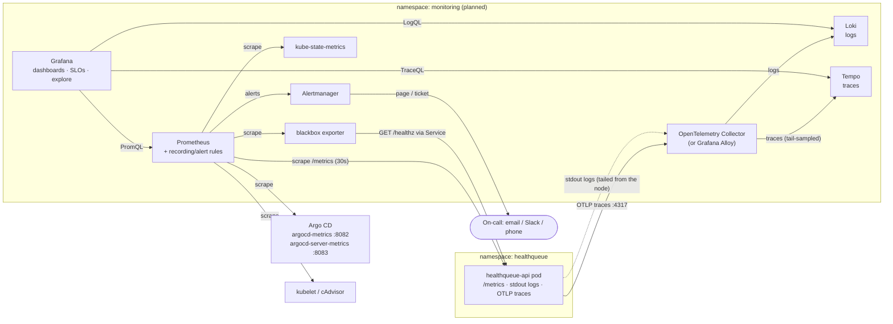

# HealthQueue Monitoring Plan

Observability plan for the HealthQueue appointment scheduling API: what we measure, the
reliability targets we commit to, how we alert, and how we respond to incidents.

| | |
|---|---|
| **Service** | `healthqueue-api` (FastAPI), namespace `healthqueue`, kind cluster `healthqueue` |
| **Users** | Patients and front-desk staff booking, viewing and cancelling appointments |
| **Owner** | Abdullahi Mohamed (on-call for this capstone) |
| **Status** | Plan + validated alert rules. **No monitoring stack is installed yet** (see [Rollout](#8-rollout-plan)). |
| **Rule files** | [`observability/prometheus/healthqueue-rules.yaml`](../observability/prometheus/healthqueue-rules.yaml) (34 rules, unit-tested with `promtool`) |

---

## 1. What already exists

The API already exposes Prometheus metrics at `GET /metrics` (`app/main.py`). These are the
raw material for every SLI below. Nothing new has to be added to the app to start measuring SLOs.

| Metric | Type | Labels | Use |
|---|---|---|---|
| `http_requests_total` | counter | `method`, `route`, `status` | Traffic, errors → **availability SLI** |
| `http_request_duration_seconds` | histogram, buckets `0.025 … 0.3 … 2.5` s | `method`, `route` | Latency → **latency SLI** (the `0.3` bucket is the SLO threshold) |
| `process_resident_memory_bytes`, `process_cpu_seconds_total`, `process_open_fds` | gauge/counter | — | Saturation of the Python process |
| `python_gc_*`, `python_info` | various | — | Runtime health |

Design points that make these metrics SLO-ready:

- **`route` is the route template** (`/appointments/{appt_id}`), not the raw URL, so cardinality
  stays bounded and no IDs leak into metric labels. Unknown paths are recorded as `route="unmatched"`.
- `/metrics` scrapes are not counted, so monitoring does not inflate traffic.
- Unhandled exceptions are recorded as `status="500"` (the middleware defaults to 500).

**Measured baseline** (2026-10-24, live pod, 100 sequential `GET /patients`): mean server-side
latency **1.5 ms**. The 300 ms latency target therefore leaves wide headroom for a real database later.

> **Probe traffic must be excluded.** Kubelet liveness/readiness probes hit `/healthz` and `/readyz`
> continuously (70 probe requests were already counted minutes after the pod started). Counted in the SLI,
> they would make availability look better than users actually experience. Every SLI below filters
> `route!~"/healthz|/readyz|unmatched"`.

---

## 2. SLIs and SLOs

### 2.1 Service Level Indicators

| SLI | Definition (good events / valid events) | PromQL (5-minute window) |
|---|---|---|
| **Availability** | Business requests that did **not** return a 5xx ÷ all business requests | `1 - healthqueue:error_ratio:rate5m` |
| **Latency** | Business requests served in **≤ 300 ms** ÷ all business requests | `1 - healthqueue:slow_ratio:rate5m` |
| **Synthetic availability** | Successful `/healthz` probes through the Service ÷ all probes (blackbox exporter, every 30 s) | `avg_over_time(probe_success{job="blackbox-healthqueue"}[5m])` |

Raw expressions behind the recording rules:

```promql
# Availability: error ratio
sum(rate(http_requests_total{job="healthqueue-api",route!~"/healthz|/readyz|unmatched",status=~"5.."}[5m]))
/
sum(rate(http_requests_total{job="healthqueue-api",route!~"/healthz|/readyz|unmatched"}[5m]))

# Latency: share of requests slower than 300 ms
1 - (
  sum(rate(http_request_duration_seconds_bucket{job="healthqueue-api",route!~"/healthz|/readyz|unmatched",le="0.3"}[5m]))
  /
  sum(rate(http_request_duration_seconds_count{job="healthqueue-api",route!~"/healthz|/readyz|unmatched"}[5m]))
)
```

**Why 4xx counts as "good":** `404 Patient not found`, `409 Provider already booked` and `422` validation
errors are correct answers to bad or conflicting requests. They are tracked separately as a business
signal (booking-conflict rate) but do not burn the error budget.

**Why a synthetic SLI too:** the request-based SLIs are blind during a total outage. If the pod is down,
no requests reach it and no errors are recorded. The blackbox probe (and the `TargetDown` alert) covers that gap.

### 2.2 Service Level Objectives

All SLOs are measured over a **rolling 30-day window**.

| SLO | Target | Error budget |
|---|---|---|
| **Availability** | **99.5 %** of business requests succeed (non-5xx) | 0.5 % of requests |
| **Latency** | **95 %** of business requests complete in ≤ 300 ms | 5 % of requests |
| **Synthetic availability** | **99.5 %** of `/healthz` probes succeed | 0.5 % of probes |

Guardrail (alerted on, not an SLO): **p99 latency ≤ 1 s**.

**Why 99.5 % and not 99.9 %:** the current architecture is a **single replica with an in-memory store**,
on a single-node local cluster. A node problem or pod restart is a full outage, and one bad rollout
could spend a 99.9 % budget (43 min) in a single incident. 99.5 % is a target this design can honestly
meet. Raise it to 99.9 % once a shared database and ≥ 2 replicas exist ([Known gaps](#9-known-gaps)).

### 2.3 Thirty-day error budget

A 30-day window has **30 × 24 × 60 = 43,200 minutes** (720 hours).

**Availability, 99.5 %:**

```
Error budget   = 1 - 0.995 = 0.005 (0.5 %)
Time budget    = 0.005 × 43,200 min = 216 min = 3 h 36 min of full outage per 30 days
Request budget = 0.005 × total requests
```

Worked example (assumed volume, for illustration): 2,000 business requests/hour ×
720 h = **1,440,000 requests / 30 days**:

| SLO | Budget share | Allowed "bad" requests in 30 days |
|---|---|---|
| Availability 99.5 % | 0.5 % | 0.005 × 1,440,000 = **7,200 failed requests** |
| Latency 95 % ≤ 300 ms | 5 % | 0.05 × 1,440,000 = **72,000 slow requests** |

How the target choice changes the time budget:

| Availability target | Allowed downtime / 30 days |
|---|---|
| 99 % | 432 min (7 h 12 min) |
| **99.5 % (chosen)** | **216 min (3 h 36 min)** |
| 99.9 % | 43.2 min |
| 99.95 % | 21.6 min |

**Budget remaining** is recorded continuously (1 = full budget, 0 = exhausted, < 0 = SLO breached):

```promql
healthqueue:availability:error_budget_remaining   # 1 - (1 - SLI_30d) / (1 - 0.995)
healthqueue:latency:error_budget_remaining        # 1 - (1 - SLI_30d) / (1 - 0.95)
```

Example: if the 30-day availability is 99.7 %, the budget used is 0.3 / 0.5 = 60 %, so **40 % remains**.

### 2.4 Burn rate

Burn rate = how fast the budget is being spent relative to "exactly on target". A burn rate of 1
spends the whole budget in exactly 30 days. The alert thresholds below follow the multiwindow,
multi-burn-rate method from the Google SRE Workbook (ch. 5):

| Burn rate | Error-ratio threshold (availability) | Slow-ratio threshold (latency) | Budget spent in long window | Budget gone in |
|---|---|---|---|---|
| 14.4× | 14.4 × 0.5 % = **7.2 %** | 14.4 × 5 % = **72 %** | 2 % in 1 h | ~2 days |
| 6× | **3 %** | **30 %** | 5 % in 6 h | 5 days |
| 3× | **1.5 %** | **15 %** | 10 % in 1 day | 10 days |
| 1× | **0.5 %** | **5 %** | 10 % in 3 days | 30 days |

### 2.5 Error budget policy

| Budget remaining (30 d) | Action |
|---|---|
| > 50 % | Normal delivery. Merges to `main` deploy automatically via Argo CD. |
| 25–50 % | Risky changes (dependency bumps, store changes) need a second review and a watched rollout. |
| 0–25 % | Only low-risk changes and reliability fixes. Each deploy is watched on the SLO dashboard for 30 min. |
| Exhausted (≤ 0) | **Feature freeze**: only reliability work and security fixes until the 30-day SLI is back above target. A postmortem is required. |

---

## 3. Architecture

How each tool fits. None of this is installed yet; [§8](#8-rollout-plan) lists the options.



| Component | Role in HealthQueue | Why it fits |
|---|---|---|
| **Prometheus** | Scrapes the existing `/metrics` endpoint every 30 s (pull model). Also scrapes kube-state-metrics, kubelet/cAdvisor, Argo CD and the blackbox exporter. Evaluates the recording rules (SLIs, budget) and alert rules in `observability/prometheus/`. | The app already speaks the Prometheus format, so there is no code change. The rules are plain YAML kept in Git next to the app. |
| **Alertmanager** | Groups, de-duplicates and routes alerts: `severity=page` notifies right away, `severity=ticket` goes to a queue or email. Inhibits symptom alerts when `HealthQueueTargetDown` is already firing. | It ships with Prometheus, so routing stays separate from detection. |
| **Grafana** | One pane of glass: the SLO dashboard (§4.4), log search and trace search. Connects the three signals: **exemplars** on latency panels jump to a Tempo trace, and a Loki **derived field** turns a `trace_id` in a log line into a Tempo link. | It queries Prometheus, Loki and Tempo natively, so you go from a symptom to its cause in a few clicks. |
| **Loki** | Stores pod stdout/stderr, indexed only by a few labels (`namespace`, `pod`, `container`, `level`). Log lines are queried with LogQL. | Cheap: it indexes labels, not full text. It uses the same label model as Prometheus, so a dashboard filter applies to both. |
| **Tempo** | Stores distributed traces and looks them up by trace ID; TraceQL search (e.g. slow `POST /appointments`). Its metrics-generator can derive span metrics and a service graph. | It needs only object storage (no index to run), and it's the natural backend for OTLP traces in the Grafana stack. |
| **OpenTelemetry** | **SDK** in the app: `opentelemetry-instrumentation-fastapi` creates a span per request, with `service.name=healthqueue-api` and `service.version=$APP_VERSION` (the git SHA, so every trace points to the exact deploy commit). **Collector**: receives OTLP, adds Kubernetes metadata (`k8sattributes`), **redacts sensitive attributes**, tail-samples, batches and exports traces to Tempo and logs to Loki. | Vendor-neutral: the backend can change (Tempo → any OTLP backend) without touching app code. The Collector is also the one place that enforces privacy (redaction) and controls cost (sampling). |

---

## 4. Signals

### 4.1 Metrics (RED + USE + delivery)

| Signal | Source | Query / note |
|---|---|---|
| **Rate**: requests/s by route | app | `sum by (route) (rate(http_requests_total{job="healthqueue-api",route!~"/healthz\|/readyz"}[5m]))` |
| **Errors**: 5xx ratio by route | app | `healthqueue:error_ratio:rate5m`; breakdown `sum by (route,status) (rate(http_requests_total{status=~"5.."}[5m]))` |
| **Duration**: p50/p95/p99 | app | `histogram_quantile(0.95, sum by (le) (rate(http_request_duration_seconds_bucket{job="healthqueue-api"}[5m])))` |
| **Booking conflict rate** (business) | app | `sum(rate(http_requests_total{route="/appointments",method="POST",status="409"}[1h])) / sum(rate(http_requests_total{route="/appointments",method="POST"}[1h]))`. A spike means a double-booking problem or a UI bug. |
| Bookings and cancellations per hour (business) | app | `sum(increase(http_requests_total{route="/appointments",method="POST",status="201"}[1h]))`, same for `DELETE … status="200"` |
| **Saturation**: memory vs 192 Mi limit | cAdvisor + kube-state-metrics | `container_memory_working_set_bytes{namespace="healthqueue",container="api"}` / `kube_pod_container_resource_limits{resource="memory"}` |
| CPU throttling (500m limit) | cAdvisor | `rate(container_cpu_cfs_throttled_periods_total{namespace="healthqueue"}[5m])` |
| Restarts / OOMKills | kube-state-metrics | `kube_pod_container_status_restarts_total`, `kube_pod_container_status_last_terminated_reason{reason="OOMKilled"}` |
| Replicas available | kube-state-metrics | `kube_deployment_status_replicas_available{deployment="healthqueue-api"}` |
| **Delivery**: sync and health | Argo CD | `argocd_app_info{name="healthqueue-api"}` (labels `sync_status`, `health_status`), `argocd_app_sync_total` |

Scrape setup when Prometheus is installed: a `ServiceMonitor` selecting
`app.kubernetes.io/name: healthqueue-api`, port `http`, path `/metrics`, interval 30 s. With the
Prometheus Operator, the `job` label defaults to the Service name (`healthqueue-api`), which is what
the rules expect.

### 4.2 Logs

**Today:** uvicorn writes plain-text access logs to stdout, one line per request:

```
INFO:     10.244.0.1:46028 - "GET /healthz HTTP/1.1" 200 OK
```

**Privacy problem:** the access log contains the **full URL including the query string**, so
`GET /appointments?patient_id=p-001` writes a patient identifier into the logs. The data in this
project is fictional, but the plan treats it as protected health information (PHI): logs must follow
the *minimum necessary* principle.

**Target format:** structured JSON, one object per request:

```json
{"ts":"2026-10-24T00:15:02.311Z","level":"info","msg":"request",
 "method":"POST","route":"/appointments","status":409,"duration_ms":4.2,
 "request_id":"5b0c…","trace_id":"4bf92f3577b34da6a3ce929d0e0e4736","span_id":"00f067aa0ba902b7",
 "version":"5975284fd1cf…"}
```

Logging rules:
- Log the **route template**, never the raw path or query string. Never log request or response bodies, patient names, dates of birth or contact details. If an identifier is truly needed, log a salted hash.
- Include `trace_id`/`span_id` (taken from the OpenTelemetry context) so Grafana can jump from a log line to its trace.
- Turn off uvicorn's default access log (`--no-access-log`) once the JSON request log exists, to avoid duplicates.
- Loki labels stay low-cardinality: `namespace`, `pod`, `container`, `level`. **Never** use `trace_id`, `request_id` or patient fields as labels.
- Retention: 30 days (matches the SLO window). Access to logs is restricted to the operations role.

Useful LogQL:

```logql
# Today (plain text): 5xx responses
{namespace="healthqueue", container="api"} |~ `" 5\d\d `

# After JSON logging: failed requests, slowest first
{namespace="healthqueue", container="api"} | json | status >= 500
{namespace="healthqueue", container="api"} | json | duration_ms > 300

# 5xx rate from logs (cross-check against the metric during an incident)
sum(rate({namespace="healthqueue", container="api"} | json | status >= 500 [5m]))
```

### 4.3 Traces

- **Instrumentation:** `opentelemetry-instrumentation-fastapi`, plus one manual span around `Store.create_appointment` (the conflict check is the only non-trivial logic). Span attributes: `http.route`, `http.response.status_code`, `appointment.provider_id`. **No patient attributes.**
- **Export:** OTLP/gRPC to the Collector at `otel-collector.monitoring:4317`, configured with the standard `OTEL_EXPORTER_OTLP_ENDPOINT` and `OTEL_SERVICE_NAME` environment variables in `k8s/deployment.yaml`.
- **Sampling** (tail-based, in the Collector): keep **100 % of errors**, **100 % of requests slower than 300 ms** (exactly the requests that burn the latency budget) and **10 %** of the rest.
- **Correlation:** `prometheus_client` histograms support **exemplars**. Recording the current `trace_id` with each latency observation lets a Grafana latency panel link straight to a slow trace in Tempo.

### 4.4 Grafana dashboard: "HealthQueue SLO"

| Row | Panels |
|---|---|
| SLO summary | 30-day availability and latency SLI (stat), error budget remaining (gauge), burn rate 1h / 6h (time series) |
| Golden signals | Requests/s by route; 5xx ratio by route; latency p50/p95/p99 and heatmap from histogram buckets |
| Business | Bookings/h, cancellations/h, booking-conflict (409) rate |
| Platform | Pod ready/restarts, memory vs limit, CPU throttling, Argo CD sync/health and deployed revision (deploy annotations) |
| Investigate | Loki log panel filtered to `status >= 500`; Tempo search for `duration > 300ms` |

---

## 5. Alerting

All rules live in [`observability/prometheus/healthqueue-rules.yaml`](../observability/prometheus/healthqueue-rules.yaml) and are
covered by unit tests in `healthqueue-rules.test.yaml`:

```bash
promtool check rules observability/prometheus/healthqueue-rules.yaml   # SUCCESS: 34 rules found
promtool test rules  observability/prometheus/healthqueue-rules.test.yaml   # SUCCESS
```

The tests prove that a 10 % error rate pages, that 0.1 % errors stay silent even when every
`/healthz` probe is failing (probe traffic is excluded), and that a 50 % slow-request ratio fires the
6× latency alert but not the 14.4× one.

| Alert | Condition | For | Severity |
|---|---|---|---|
| `HealthQueueAvailabilityBurnFast` | error ratio > **7.2 %** over 1 h **and** 5 m (14.4×) | 2m | **page** |
| `HealthQueueAvailabilityBurnMedium` | error ratio > **3 %** over 6 h and 30 m (6×) | 15m | **page** |
| `HealthQueueAvailabilityBurnSlow` | error ratio > **1.5 %** over 1 d and 2 h (3×) | 1h | ticket |
| `HealthQueueAvailabilityBurnChronic` | error ratio > **0.5 %** over 3 d and 6 h (1×) | 3h | ticket |
| `HealthQueueLatencyBurnFast` | slow ratio (> 300 ms) > **72 %** over 1 h and 5 m | 2m | **page** |
| `HealthQueueLatencyBurnMedium` | slow ratio > **30 %** over 6 h and 30 m | 15m | **page** |
| `HealthQueueLatencyBurnSlow` / `…Chronic` | slow ratio > **15 %** (1 d / 2 h), > **5 %** (3 d / 6 h) | 1h / 3h | ticket |
| `HealthQueueLatencyP99High` | p99 > **1 s** | 10m | ticket |
| `HealthQueueTargetDown` | `up == 0` or target missing | 2m | **page** |
| `HealthQueueProbeFailing` | blackbox `/healthz` probe failing | 2m | **page** |
| `HealthQueuePodRestarting` | > 2 container restarts in 30 min | — | ticket |
| `HealthQueueMemoryNearLimit` | working set > **90 %** of the 192 Mi limit | 10m | ticket |
| `HealthQueueArgoCDDegraded` | Argo CD health not Healthy/Progressing | 10m | **page** |
| `HealthQueueArgoCDOutOfSync` | not Synced (auto-sync failing) | 15m | ticket |

Why two windows: the long window proves the budget is really being spent; the short window makes
the alert **stop** soon after the problem is fixed. Every alert links its runbook (§7) through
`runbook_url`.

**Routing (Alertmanager):** `page` notifies on-call at any hour; `ticket` opens an issue reviewed the
next working day. Group by `alertname`; repeat interval 4 h for pages. While
`HealthQueueTargetDown` fires, inhibit the burn-rate and probe alerts (same root cause).

---

## 6. Incident response

### 6.1 Severity

| Severity | Definition | Typical trigger | Acknowledge | Updates |
|---|---|---|---|---|
| **SEV1** | Patients cannot book or view appointments | `TargetDown`, `ProbeFailing`, `AvailabilityBurnFast` | 5 min | every 30 min |
| **SEV2** | Degraded: slow or partially failing, budget burning fast | `AvailabilityBurnMedium`, `LatencyBurn*` (page), `ArgoCDDegraded` | 15 min | every hour |
| **SEV3** | No user impact yet; budget at risk | any `ticket` alert | next working day | in the ticket |

### 6.2 Process

1. **Detect:** an alert fires (or a user reports a problem). The on-call engineer acknowledges and becomes **Incident Commander (IC)**. In this one-person capstone, the IC also does the hands-on work and the communication.
2. **Triage (≤ 10 min):** confirm the impact on the SLO dashboard. Which SLI, which routes, since when? **Check the last deploy first**: most incidents follow a change.
   ```bash
   kubectl --context kind-healthqueue -n argocd get application healthqueue-api \
     -o jsonpath='{range .status.history[*]}{.id} {.revision} {.deployedAt}{"\n"}{end}'
   git log --oneline -5 -- k8s/
   ```
3. **Mitigate before you diagnose:** if the incident started after a deploy, **roll back** (§6.3). Restoring service comes before finding the root cause.
4. **Resolve:** SLIs are back within the SLO and burn-rate alerts have cleared (the short window makes this quick).
5. **Follow up:** a blameless postmortem within 5 working days for any SEV1/SEV2, or for any incident that used more than 20 % of the monthly budget. Record how much budget was used and apply the [error budget policy](#25-error-budget-policy).

### 6.3 Rollback through GitOps

Argo CD auto-sync (with `selfHeal`) is on, so **Git is the only place a rollback can happen**.
Argo CD refuses a UI or CLI rollback while auto-sync is enabled, and `kubectl` edits are reverted
automatically.

```bash
git pull
git log --oneline -5 -- k8s/kustomization.yaml     # find the bad "deploy: healthqueue-api <sha>" commit
git revert --no-edit <deploy-commit>               # restores the previous signed image digest
git push                                           # Argo CD syncs the old digest within ~3 min
kubectl --context kind-healthqueue -n argocd get application healthqueue-api   # wait for Synced / Healthy
```

The revert commit's message contains the original `[skip ci]`, so CI does not rebuild and re-bump the
bad code. The fix then goes forward through a normal pull request. To roll back faster, trigger a
refresh in the Argo CD UI or run `argocd app sync healthqueue-api`.

### 6.4 Postmortem template

`docs/postmortems/YYYY-MM-DD-<title>.md`. Sections: summary · impact (duration, failed requests,
**% of error budget used**) · timeline (UTC) · root cause · what went well / badly · action items
(owner, due date). Blameless: describe systems and decisions, not people.

---

## 7. Runbooks

<a id="rb-availability"></a>
### 7.1 Availability burn (5xx errors)
1. On the dashboard: which `route` and `status`? All routes (pod-wide) or one handler?
2. `kubectl --context kind-healthqueue -n healthqueue get pods` and `kubectl … logs deploy/healthqueue-api --tail=200`. Look for tracebacks.
3. Did it start with a deploy (compare with Argo CD history)? → **roll back** (§6.3).
4. No deploy? Check memory/restarts (§7.4) and node pressure. Open the matching 5xx traces in Tempo.

<a id="rb-latency"></a>
### 7.2 Latency burn / p99 high
1. p95/p99 by route: one slow endpoint or all of them?
2. All routes slow: check CPU throttling (500m limit) and node pressure. **This happened locally on
   2026-10-23**: with two kind clusters on a 3.7 GiB Docker VM, probes timed out and pods restarted.
   Fix: free node resources, or raise `resources.limits.cpu`.
3. One route slow: search Tempo for `duration > 300ms` on that route and find the slow span.

<a id="rb-down"></a>
### 7.3 Target down / probe failing
1. `kubectl --context kind-healthqueue -n healthqueue get pods,rs,events --sort-by=.lastTimestamp`
2. `ImagePullBackOff`: check that the digest in `k8s/kustomization.yaml` exists on GHCR and that the package is still public.
3. `CrashLoopBackOff`: `kubectl … logs <pod> --previous`.
4. No pod at all: check ReplicaSet events for **Pod Security** rejections (the namespace enforces `restricted`).
5. A bad deploy → roll back (§6.3).

<a id="rb-restarts"></a>
### 7.4 Restarts / memory near limit
1. Find the reason: `kubectl … get pod <pod> -o jsonpath='{.status.containerStatuses[0].lastState.terminated.reason}'`. `OOMKilled` points to the 192 Mi limit; a liveness-probe kill points to an overloaded node.
2. **Every restart wipes all appointments** (in-memory store). Treat repeated restarts as data loss, not just a blip.
3. Raise the limit in `k8s/deployment.yaml` through a PR, or find the leak with memory-over-time per version.

<a id="rb-deploy"></a>
### 7.5 Argo CD degraded / out of sync
1. `kubectl --context kind-healthqueue -n argocd get application healthqueue-api -o jsonpath='{.status.conditions}'` and the `operationState.message`.
2. Degraded right after a `deploy:` commit: the new image is failing → roll back (§6.3).
3. Out of sync with a sync error: an invalid manifest was merged. Fix forward in Git. Run `kubectl kustomize k8s` locally before you push.
4. Check that the running image is the signed one: `cosign verify ghcr.io/abdullahim571/healthqueue-devops-capstone@<digest> …` (see README).

---

## 8. Rollout plan

No monitoring services are installed. Each phase needs approval, because it changes the cluster and
uses memory: the Docker VM has 3.7 GiB, shared with the ShipFast cluster.

| Phase | What | Approx. memory | Cost |
|---|---|---|---|
| 1 | Prometheus + Alertmanager + Grafana + kube-state-metrics (kube-prometheus-stack Helm chart, trimmed), `ServiceMonitor`, load `healthqueue-rules.yaml` as a `PrometheusRule`, blackbox exporter | ~0.6–1 GiB | $0 (open source) |
| 2 | Structured JSON logging in the app (code change + tests), Grafana Alloy / OTel Collector shipping logs to Loki (single-binary mode) | +~0.3–0.5 GiB | $0 |
| 3 | OpenTelemetry SDK in the app, tail sampling in the Collector, Tempo (monolithic), exemplars + derived fields in Grafana | +~0.3–0.5 GiB | $0 |
| Alt. | Run only the Collector/Alloy in-cluster and send everything to Grafana Cloud's free tier | ~0.1–0.2 GiB | $0 within free-tier limits; data leaves the machine (acceptable here: all data is fictional) |

Memory figures are rough planning estimates for a single-node lab setup, not measurements. Monitoring
manifests go in their own Argo CD Application (not `k8s/`), so the app's sync can't break because of
the monitoring stack.

---

## 9. Known gaps

| Gap | Impact | Fix |
|---|---|---|
| Single replica, in-memory store | Any restart is an outage **and** data loss; limits the SLO to 99.5 % | Shared database (e.g. PostgreSQL) + ≥ 2 replicas + PodDisruptionBudget, then raise the SLO to 99.9 % |
| Latency histogram has no `status` label | The latency SLI includes fast 4xx/5xx responses | Add a `status_class` label (`2xx`/`4xx`/`5xx`; still low cardinality) |
| No build-info metric | Dashboards can't mark deploys from metrics alone | `healthqueue_build_info{version="<git sha>"} 1` |
| Plain-text access logs with query strings | Possible patient identifiers in logs; hard to query | JSON request log with route templates (§4.2) |
| No tracing | Slow requests can't be broken down | OpenTelemetry SDK (§4.3) |
| Local single-node cluster | Node or Docker Desktop restarts take everything down; shared resources with other clusters | Acceptable for the capstone; a managed multi-node cluster in production |
